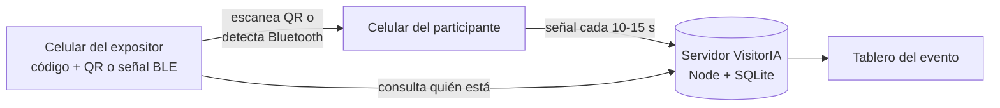

# VisitorIA

> **Diseño y desarrollo: Ing. Alonso Gamez**

**Mide el networking de tu evento.** VisitorIA registra cuántas personas se acercan a cada expositor y cuánto tiempo se quedan, y lo convierte en un tablero de indicadores para saber qué stands generaron más conexiones.

- Los expositores activan su stand desde el celular y obtienen un código.
- Los participantes se enlazan a cada stand **escaneando un QR** (versión web) o **por proximidad Bluetooth** (app nativa).
- El organizador ve en vivo el ranking de expositores, tiempos, afluencia, embudo de conversación y recorridos.

---

## Contenido

1. [Cómo funciona](#cómo-funciona)
2. [Funciones](#funciones)
3. [Instalación](#instalación)
4. [Guía de uso](#guía-de-uso)
5. [App Bluetooth (Flutter)](#app-bluetooth-flutter)
6. [Indicadores del tablero](#indicadores-del-tablero)
7. [Configuración](#configuración)
8. [API](#api)
9. [Estructura del proyecto](#estructura-del-proyecto)
10. [Limitaciones y siguientes pasos](#limitaciones-y-siguientes-pasos)

---

## Cómo funciona



1. **El expositor** registra su stand en un evento y recibe un **código de 6 caracteres** (por ejemplo `TAAXP7`).
2. **El participante** se enlaza a ese stand:
   - **Versión web:** escanea el QR del stand con la cámara del celular, sin instalar nada.
   - **Versión Bluetooth:** la app detecta automáticamente el stand más cercano por intensidad de señal.
3. Mientras el participante está en el stand, su celular envía una señal periódica al servidor. Con eso se calcula el **tiempo de permanencia**.
4. La visita termina cuando el participante la cierra, se enlaza a otro stand o pasan **60 segundos sin señal**.
5. **El tablero** agrega todas las visitas en indicadores por evento, expositor y participante.

Una persona solo puede estar enlazada a **un stand a la vez**. En Bluetooth se asigna al stand con la señal más fuerte.

---

## Funciones

### App web (cualquier celular, sin instalar)

| Rol | Qué puede hacer |
|---|---|
| **Expositor** | Crear o elegir un evento · registrar su stand · ver su código y QR · ver en vivo quién está en su stand · contadores de personas y minutos |
| **Participante** | Registrar su nombre una sola vez · enlazarse por QR o código · ver un cronómetro de su visita · terminar o reconectar la visita |

### App Bluetooth (Android / iOS, prototipo)

| Rol | Qué puede hacer |
|---|---|
| **Expositor** | Emitir una señal Bluetooth (*beacon*) con su código · ver visitantes en vivo |
| **Participante** | Recorrido automático: detecta stands cercanos, muestra la proximidad (Platicando / Muy cerca / Cerca) y registra la visita sin escanear nada |

### Tablero del organizador

- Selector de evento, actualización automática cada 10 s y exportación a **CSV**.
- **Indicadores clave:** participantes, expositores, conexiones, horas de networking, duración promedio, % de conversaciones y % de participantes que regresaron.
- **Gráficas:** ranking de expositores, duración de conexiones, afluencia durante el día, embudo de atracción, tasa de conversación por expositor y mapa de calor de stand por hora.
- **Tablas:** expositores (con cercanía Bluetooth), participantes más activos, flujo entre stands y conexiones recientes.
- Botón **Cargar evento demo** que genera 8 expositores y 120 participantes para explorar el tablero.
- Modo claro y oscuro automático.

---

## Instalación

### Requisitos

- **Node.js 22 o superior.** Usa el módulo `node:sqlite` integrado, así que **no requiere `npm install`**.
- Para la app Bluetooth: Flutter 3.x y Android Studio. Ver [App Bluetooth](#app-bluetooth-flutter).

### Arrancar el servidor

```bash
git clone https://github.com/Zaetafxe/GemellIA.git
cd GemellIA
node server.js
```

La consola muestra las direcciones:

```
  VisitorIA corriendo
  Local:    http://localhost:3000
  Celular:  http://192.168.1.20:3000   (misma red Wi-Fi)
  Tablero:  http://localhost:3000/dashboard.html
```

- Los datos se guardan en `visitoria.db` (SQLite), que se crea automáticamente.
- Para cambiar el puerto: `PORT=8080 node server.js` (en PowerShell: `$env:PORT=8080; node server.js`).

---

## Guía de uso

### 1. Antes del evento (organizador)

1. Arranca el servidor en una PC o servidor accesible desde la red del evento.
2. Comparte con los expositores la dirección de la app, por ejemplo `http://192.168.1.20:3000`.
3. Opcional: abre el tablero y pulsa **Cargar evento demo** para familiarizarte con los indicadores.

### 2. Expositor: activar su stand

1. Abre la app y elige **Soy expositor**.
2. Selecciona el evento o crea uno nuevo (nombre, fecha y sede).
3. Escribe el nombre del stand y la empresa, y pulsa **Generar mi código**.
4. Deja la pantalla con el **QR y el código** visible en el stand, o impreso.
5. En la misma pantalla verás quién está en tu stand ahora, cuántas personas te visitaron y los minutos acumulados.

> El código se recuerda en el celular. Si cierras la app, se reabre en tu stand. Para usar otro stand, pulsa **Cambiar de stand**.

### 3. Participante: enlazarse a un stand

1. Escanea el QR del stand con la **cámara normal** del celular; se abre VisitorIA con el código ya puesto.
2. La primera vez escribe tu nombre (y empresa si quieres) y pulsa **Enlazar**.
3. Verás el nombre del stand y un cronómetro. **Mantén la pantalla abierta** mientras platicas.
4. Al irte pulsa **Terminar visita**, o simplemente escanea el QR del siguiente stand.

> Si la visita se cierra por inactividad (por ejemplo, porque bloqueaste el celular), pulsa **Reconectar**.

### 4. Organizador: consultar el tablero

1. Abre `http://<servidor>:3000/dashboard.html`.
2. Elige el evento en el selector; la URL guarda la selección (`?event=1`) para compartirla.
3. El tablero se actualiza solo cada 10 s y muestra los stands activos con un punto verde.
4. Pulsa **Exportar CSV** para descargar todas las visitas: evento, expositor, participante, inicio, fin, duración, fuente y señal.

---

## App Bluetooth (Flutter)

Prototipo nativo en [`mobile/`](mobile/). Usa el mismo servidor y el mismo tablero que la versión web.

### Cómo se identifica cada stand

El celular del expositor anuncia un **Service UUID** Bluetooth con el código incrustado:

```
56495349-5441-4000-8000-XXXXXXXXXXXX
└── "VISITA" ──┘          └ código en ASCII hex
TAAXP7  →  56495349-5441-4000-8000-544141585037
```

El participante escanea, conserva la mejor señal (RSSI) de cada stand cada 10 s y la envía a `POST /api/sightings`. El servidor solo cuenta el stand con la señal más fuerte y por encima de `RSSI_MIN`.

### Compilar e instalar

1. Instala **Android Studio** (incluye el SDK de Android) y verifica con `flutter doctor`.
2. Activa la **Depuración USB** en un Android físico. El emulador no tiene Bluetooth.
3. Ejecuta:
   ```bash
   cd mobile
   flutter pub get
   flutter run          # o: flutter build apk --release
   ```
4. En la app, pulsa **⚙ Servidor** y escribe `http://<IP-de-tu-PC>:3000`.
5. Para probar necesitas **dos celulares**: uno como expositor y otro como participante.

### Uso

- **Expositor:** *Soy expositor* → registra el stand o escribe su código → la app empieza a **emitir**. Deja el celular en el stand con la app abierta.
- **Participante:** *Soy participante* → nombre → **Comenzar recorrido**. La app lista los stands detectados con su proximidad, y al acercarte a uno se inicia la visita automáticamente.

| Señal (RSSI) | Etiqueta | Distancia aproximada |
|---|---|---|
| -60 dBm o más | Platicando | menos de 1 m |
| -61 a -70 dBm | Muy cerca | 1 a 2 m |
| -71 a -80 dBm | Cerca | 2 a 5 m |
| menos de -80 dBm | Lejos (no cuenta) | más de 5 m |

> Las distancias son orientativas: el RSSI cambia según el modelo de celular, la gente alrededor y el lugar. Calibra `RSSI_MIN` en el evento.

---

## Indicadores del tablero

| Indicador | Definición | Para qué sirve |
|---|---|---|
| **Participantes** | Personas distintas con al menos una visita | Alcance del evento |
| **Conexiones** | Visitas participante ↔ expositor | Volumen de interacción |
| **Tiempo total de networking** | Suma de la duración de todas las visitas | Valor total generado |
| **Duración promedio** | Tiempo total ÷ conexiones | Calidad de la interacción |
| **Conversaciones** | Visitas de **2 min o más** | Interés real frente a paso casual |
| **Regresaron** | Participantes que volvieron al mismo stand | Interés sostenido |
| **Embudo de atracción** | Se acercaron → se detuvieron (30 s o más) → conversaron (2 min o más) | Dónde se pierde a los visitantes |
| **Tasa de conversación** | % de las conexiones de un stand que fueron conversaciones | Qué stand convierte mejor, no solo cuál atrae más |
| **Ranking de expositores** | Minutos totales por stand | Qué expositor generó más networking |
| **Afluencia** | Personas enlazadas cada 15 min | Horas pico del evento |
| **Mapa de calor** | Personas distintas por stand y por hora | Cuándo brilla cada stand |
| **Flujo entre stands** | Transiciones más comunes A → B | Recorridos y stands complementarios |
| **Cercanía BLE** | Señal promedio de las visitas por Bluetooth | Diferencia entre pasar cerca y platicar |
| **% Bluetooth** | Conexiones por BLE frente a QR | Adopción de cada método |

---

## Configuración

Constantes al inicio de [`server.js`](server.js):

| Constante | Valor por defecto | Descripción |
|---|---|---|
| `PORT` | `3000` | Puerto HTTP (también por variable de entorno) |
| `PING_TIMEOUT_MS` | `60000` | Sin señal durante este tiempo, la visita se cierra |
| `CONVERSATION_MS` | `120000` | Duración mínima para contar como conversación |
| `RSSI_MIN` | `-80` | Señal Bluetooth mínima para contar como "cerca" |

En la app Flutter ([`mobile/lib/main.dart`](mobile/lib/main.dart)): `kReportEvery` (10 s) es el intervalo de reporte de avistamientos.

---

## API

Todas las rutas reciben y devuelven JSON.

| Método | Ruta | Descripción |
|---|---|---|
| `GET` | `/api/events` | Lista de eventos |
| `POST` | `/api/events` | Crear evento `{ name, date, venue? }` |
| `POST` | `/api/exhibitors` | Registrar expositor `{ eventId, name, company? }` → devuelve `code` |
| `GET` | `/api/exhibitor?code=ABC123` | Datos del stand y quién está ahora |
| `POST` | `/api/visits/start` | Enlace por QR `{ code, visitorId, visitorName, visitorCompany? }` |
| `POST` | `/api/visits/ping` | Señal de presencia `{ visitId, visitorId }` |
| `POST` | `/api/visits/end` | Terminar visita `{ visitId, visitorId }` |
| `POST` | `/api/sightings` | Avistamientos BLE `{ visitorId, visitorName, readings: [{ code, rssi }] }` |
| `GET` | `/api/stats?eventId=1` | Datos completos del evento para el tablero |
| `POST` | `/api/demo` | Crea un evento de demostración |

### Modelo de datos (SQLite)

```
events      (id, name, date, venue, created_at)
exhibitors  (id, event_id, code, name, company, created_at)
visitors    (id, name, company, created_at)
visits      (id, exhibitor_id, visitor_id, started_at, last_seen, ended_at, source[qr|ble], rssi_sum, rssi_n)
```

---

## Estructura del proyecto

```
VisitorIA/
├── server.js              # API + servidor estático + SQLite (sin dependencias)
├── public/
│   ├── index.html         # App web: expositor y participante
│   ├── app.js             # Lógica de la app web
│   ├── dashboard.html     # Tablero de indicadores (Chart.js)
│   ├── style.css          # Estilos compartidos, modo claro/oscuro
│   ├── manifest.webmanifest
│   └── icon.svg
└── mobile/                # App nativa Bluetooth (Flutter)
    ├── lib/main.dart
    └── test/codec_test.dart
```

---

## Limitaciones y siguientes pasos

**Limitaciones actuales**

- **Web:** el tiempo se mide mientras la pantalla está abierta. Mantener la pantalla encendida (*Wake Lock*) solo funciona con **HTTPS**.
- **Bluetooth:** el prototipo escanea con la app abierta. En iOS, Apple oculta el UUID cuando la app del expositor está en segundo plano.
- No hay autenticación: cualquiera con acceso al servidor puede ver el tablero.
- La web carga el generador de QR y Chart.js desde un CDN, así que necesita internet.

**Siguientes pasos**

- [ ] Desplegar con HTTPS (Render, Railway, Fly.io) para eventos reales.
- [ ] Escaneo Bluetooth en segundo plano (servicio en primer plano de Android).
- [ ] Inicio de sesión para organizadores y tableros privados por evento.
- [ ] Comparación entre eventos y reporte PDF por expositor.
- [ ] Calibración de RSSI en el evento.

---

## Privacidad

VisitorIA guarda el **nombre** (y empresa opcional) que cada participante escribe, y los horarios de sus visitas. No guarda ubicación GPS ni datos de contacto. Antes de usarlo en un evento real, informa a los participantes y añade un aviso de privacidad acorde a la ley aplicable (por ejemplo, la LFPDPPP en México).

---

## Créditos

**Diseño y desarrollo:** Ing. Alonso Gamez
